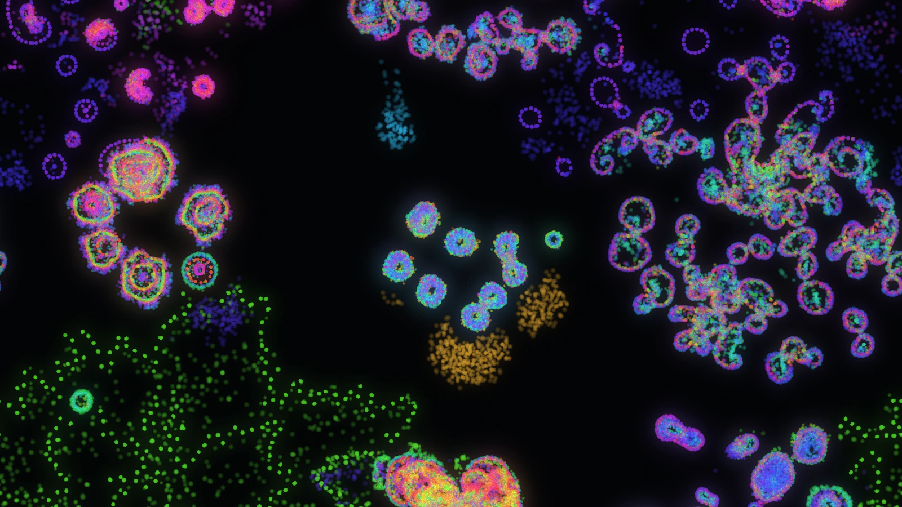

# Primordial Soup



A neural particle simulation in Rust and WGPU, based on Jesse Gelders's
MIT-licensed [Fluoddity](https://fluoddity.com/).

Particles read a shared vector trail field through two sensors. Select Fourier
(the original 80-coefficient rule), MLP (76 parameters), or GRU (128 parameters
with per-particle memory) to determine motion and color. Cohort mutation and
selection expose different collective behaviors. The simulation and rendering
run on the local GPU.

The original WGSL model, initial conditions, display pipeline, 131 shipped
presets, v8/v9 project files and share codecs are retained. The editor uses egui
on native and web. Provenance is in [docs/REFERENCE.md](docs/REFERENCE.md), and
executed evidence is in [docs/RESULTS.md](docs/RESULTS.md).

## Run on Linux / NVIDIA

Install a Rust toolchain supporting Rust 1.95 or later and a working NVIDIA
Vulkan driver, then:

```sh
make run
```

This builds and runs the release binary at normal process priority without
restricting CPU cores. To limit both the build and running app to **one CPU at
niceness 19**, opt in with:

```sh
make run LOW_PRIO=1
```

Native rendering uses the hardware adapter and refuses software GPU fallback.
Once built, `target/release/primordial-soup` also launches the app directly.
Fresh sessions start at Physics Rate **5** without automatic startup calibration.
More → Simulation → Auto-calibrate GPU runs the reference's bounded progression.
World size, physics rate, temporal samples and bloom remain adjustable.

Right-click the Physics readout above playback, or choose
More → Simulation → Auto-calibrate Physics Rate, to tune the current project using full rendered frame intervals.
This includes motion blur and bloom and preserves the simulation. Starting from
a paused view resumes it for measurement and restores that pause afterward.
Right-click again to cancel and restore the original rate; a 20-second deadline
also restores it if the run cannot receive usable frames.

**More → Simulation → Timing & Experiments** separates the simulation clock from the
display. The default Frame based mode retains Physics Rate steps per frame.
Choose Fixed simulation ticks per second to set the tick rate independently of
Presentation FPS (1–60). Each tick still executes the original particle update
and trail update, in that order. Simulation-only batches skip drawing and bloom.
Work is bounded to 120 ticks per batch; overload retains and displays clock lag.
Hardware that cannot sustain the requested work will fall behind.

**Step 1** and **Advance N** pause automatic execution and submit exactly the
requested number of ticks, including requests larger than one batch. Reset
initializes the world at tick 0; initialization is separate from these ticks.
Pausing adds no hidden settling steps. Hidden browser tabs and minimized native
windows suspend ticking without catch-up on return. Exact work waits for return;
recordings also wait, while in-flight encoding may finish. Losing focus alone
does not suspend a visible window. Idle pause uses no recurring application
repaint timer; capture, camera, calibration and save deadlines can still wake it.
An already-started webcam source remains active while hidden; stop it explicitly
when capture is no longer needed. Held drawing or navigation also needs updates.

The timing window also enables optional GPU stage profiling and displays CPU
encoding, submission-call duration, frame interval and scheduling delay. Profiling
locks calibration and does not change world size or tick settings. GPU timestamps
are feature-detected and read back asynchronously through a bounded ring. They
add measurement overhead and exclude egui composition and display presentation.
For comparisons, disable automatic calibration and match every workload setting.
Live mouse/camera input is sampled from real time; cadence-independent tick counts
do not make interactive experiments deterministic. The legacy shove normalization
also depends on the batch size.

Native video export requires `ffmpeg` with `h264_nvenc`; it uses NVIDIA's encoder
and never silently substitutes a CPU encoder. Native camera capture uses Linux
V4L2 through FFmpeg, on one low-priority thread at 15 fps. Start it explicitly
in More → Simulation → Webcam Input. Native QR image import needs `zbarimg`.
Native downloads go into `exports/` in the working directory.

**Webcam Input** turns a live camera image into forces or trail signals that
influence the particles. Choose a webcam, start it, and select edges or motion.
Refresh updates the device list without activating capture. A missing-device
error means the browser could not open a usable physical or virtual webcam;
connect one or start its virtual feed. Camera permission is requested only when
you press Start webcam. To navigate the world, use the mouse wheel to zoom and
middle-drag or WASD to pan.

**More → Share → Record World (Video)** saves the entire world without editor controls.
No webcam is required. Choose dimensions, duration and quality, then start; the
initial speed and blur follow the preview. Output uses 60 fps simulation time,
so slower encoding changes export time rather than playback speed. The output
camera, size and visual settings stay fixed while you pan, zoom or resize the
preview. Recordings default to 512×512 for 5 seconds; dimensions can reach 4096px
and duration 120 seconds. Finish early saves a partial clip; Cancel and discard
suppresses delivery. The prior pause state returns when recording ends.

Export uses one frame readback at a time and a fixed renderer allocated only
while recording. Browser clips stop at 60 MiB of compressed video or 64 MiB
including the container; encoder buffers, muxing and the download Blob can use
additional temporary memory. Discard during finalization suppresses download,
but the browser may finish its already-started muxing before releasing it.

## Cellular appearance

Fresh sessions start with the captured, modified **Diversity** project in Cells
mode at Mutation **0.2** and Physics Rate **5**. Its rule, mutation seed and four
cohorts come from the local project export; existing saved projects and preferences
still take precedence.

Choose **Inspector → Look → Cells** for density-sized particles, subtle cell
relief and a smooth color wash. Cells defaults to **Dark** with the existing
particle colors; **Light** retains the pale background. Choose either theme in
**Inspector → Look**. The green/pink palette is optional under Advanced. **Classic** is
also available. Appearance works independently of Fourier / MLP /
GRU and is included in clean PNG and video output. Paused appearance edits do
not advance the world.

Cells is more expensive: the bounded native RTX 3090 check measured 6.39 ms at
1080p with 600,000 particles and one render sample, versus 0.55 ms for Classic;
Cells-only logical storage was about 214 MiB. These are rendering measurements,
not simulation throughput or browser FPS. See the [rendering contract](docs/CELLULAR_RENDERING_SPEC.md)
and [validation report](docs/CELLULAR_RENDERING_VALIDATION.md).

The [latest optimization results](docs/OPTIMIZATION_RESULTS.md) record matched
before/after measurements and exact image comparisons for the current renderer.

## Build WebAssembly

```sh
rustup target add wasm32-unknown-unknown
python3 scripts/low-load.py cargo install wasm-bindgen-cli --version 0.2.128 --locked
make web
make serve
```

Open <http://127.0.0.1:8080/>. The generated `dist/` contains only static HTML,
JavaScript, WASM and license notices; it has no backend, API, database server or
external runtime CDN. Simulation, rendering, project storage and video encoding
all run in the visitor's browser. Use a current browser with hardware WebGPU and
HTTPS (localhost also works). WebGL/software simulation fallback is deliberately
absent. Browser video uses WebCodecs with a preference for hardware encoding;
it retries with the browser's default encoder when that preference is rejected.
The output is MP4, or WebM when only VP8 is available.

Browser projects/preferences and the optional research archive use separate
IndexedDB databases. A denied save or exhausted quota produces an error; export
JSON or a ZIP backup to keep an independent copy. An unavailable image clipboard
falls back to a PNG download. Camera permission is requested only on Start.

Useful launch options are `?preset=Segments`, `?world=0.5&steps=5`, `?paused`,
`?camera=trail`, `?debug`, and `?nocalibrate`. A copied share link carries the
project in its fragment and can suggest editor settings for the recipient to
accept. Native links for legacy Fourier projects keep the original link format.
`?ticks=300&fps=15&nocalibrate` selects fixed ticking with a slower display.

**Presets** contains **Core (22)** and **Archive (109)** from Jesse Gelders’
[Fluoddity](https://fluoddity.com/), plus **Your saved presets** stored locally.
The source is visible in the preset picker; Archive starts collapsed. Hover
previews a project, leaving cancels the preview, and clicking loads it. The quiet
FPS and configured Physics readouts stay visible above playback, including
with the inspector open. Toggle either in **Inspector → Settings → Performance**.
Costly settings use yellow/red warnings when the frame rate falls behind.

The browser build excludes the unused WebGL backend and shader compiler.
Production WASM omits name/producers metadata while retaining identical code
and data sections.
Builds stage and audit a fresh asset directory before replacing `dist`.
Content versions cover the application module graph, and HTML revalidates so
visitors discover updated controls even with cached assets.
Export textures are allocated only during screenshot/video work and released
afterwards. PNG readback copies only the selected crop and avoids a separate
full-window CPU pixel allocation. `?debug` displays committed WASM linear memory and the JS heap
(when the browser exposes it). These readings are separate from total tab RAM
and GPU memory; the recorded comparison is in [results](docs/RESULTS.md).

## Host on Cloudflare Free

Build locally with `make web`, then deploy **only `dist/`**. The included
`wrangler.toml` is an assets-only Worker configuration: it has no Worker script
or dynamic request handler. With your Cloudflare account configured:

```sh
npx wrangler deploy
```

Alternatively, create a Cloudflare Pages project with `dist` as the output
directory, or upload the prebuilt directory with:

```sh
npx wrangler pages deploy dist --project-name primordial-soup
```

Use the free `workers.dev` or `pages.dev` address. Workers static asset requests
are [free and unlimited](https://developers.cloudflare.com/workers/static-assets/billing-and-limitations/).
No Functions are needed. `scripts/check-dist.py` verifies the generated asset
sizes against the 25 MiB per-file limit and the Free Pages 20,000-file limit.

## Network modes and comparisons

Choose **Fourier / MLP / GRU** in **Inspector → World**. Each mode retains its own
rule, seed and Mutation Scale; sensors and physics settings are shared. Switching
always resets particles, swarm trails and network memory to tick 0. Painted
fields stay in place. The new modes use the same selection/adoption controls as
Fourier, and do not learn or train while running.

New MLP/GRU searches use seven observations: two local flow vectors, two
occupancy-trail samples, and their own speed. Motor outputs stay signed and
bounded; stopped particles retain a heading without receiving a random velocity
kick. MLP has 100 parameters; GRU has 164 and two independent memory streams.
Existing saved MLP/GRU rules retain their original sensors and equations.
Press **B / Randomize Behavior** to start the revised model in an older bank.
See the [IO specification](docs/NETWORK_IO_SPEC.md) and
[evaluation results](docs/NETWORK_IO_RESULTS.md).

In **More → Simulation → Timing & Experiments**, **Run N ticks** starts a clean comparison,
clears painted fields too, disables camera influence and automatic calibration,
and executes exactly the chosen tick count. Settings are locked until completion
or cancellation. **Save comparison JSON** includes the project with all mode banks,
effective sizing, GPU-read-back rule hash, and available timing data. Compare
completed ticks and matched settings; equal seeds or Mutation Scale do not imply
equivalent behavior across architectures. GPU samples are asynchronous and may
precede the final batch; completed wall time includes scheduling and suspension.

Extended projects use v10 JSON and app-specific share payloads; legacy Fourier
projects retain their original v9 format and links. An explicitly labeled
Fourier v9 export discards other modes. Native extended links default to
`http://localhost:8080/`; set `PRIMORDIAL_SOUP_URL` to the hosted app address when
sharing with another machine. Large projects may exceed QR capacity; use JSON.
Current projects, custom saves, and checkpoints retain mode banks across saves
and reloads. Runtime particle/trail/memory state is not saved. Extended research
archives use version 3; graph replay/import remains outside the app.

See [the explanation](docs/DETAILS.md), [the specification](docs/NETWORK_MODES_SPEC.md),
and [implementation evidence](docs/NETWORK_MODES_RESULTS.md).

## Explore

Start with **Presets → Core · Fluoddity**. In **Inspector → World**, choose 4 or 16 cohorts,
raise Mutation Scale and
reroll with **F**. Click a cohort to highlight it; click it again or press
**Enter** to adopt its rule and produce children. **Z / Shift+Z** undo/redo;
**C / V** set/load a checkpoint. On touch, use the explicit Adopt button.

**Space** pauses; **R** resets; **B** generates a new rule; **M** switches
particles/trails; **G** toggles Color by Cohort. **[ / ]** lower/raise Mutation
Scale by 0.01, clamped to 0–0.6. **Comma / Period** lower/raise Physics Rate
through 1, 5, 10, …, 60 steps/frame. **X** hides/restores all panels,
including the command dock, inspector, dialogs and readouts, without changing
pause or the open-window state. **Show controls · X** remains while hidden.
The bottom dock keeps playback, **Presets**, interaction tools, **Inspect**, and
**More** together. **Inspect** opens World, Look, Settings, and contextual Brush
controls. Selecting a tool leaves the inspector closed; open Brush settings
from the tool menu. Reset and stepping are also available in **More**, with
Step beside playback on desktop. See the [UI design and validation notes](docs/UI_DESIGN.md).
The physics speed bar stays visible above playback and adjusts the active
frame-based or fixed-tick clock. **X** hides it with the other controls.
The separate panel beside the physics dock has outlined buttons for **1**,
**2 × 2**, or **4 × 4** cohorts, each restarting the world.
The small **Mutation** slider beside them adjusts variation
around the parent behavior; release the slider to apply the change.
The panels stack on narrow screens and both hide with **X**.
FPS and Physics Rate readouts remain independently toggleable in
**Inspect → Settings → Performance**.
**Home** resets the view. Wheel zooms at
the pointer, middle drag or **WASD** pans, and **Q/E** zooms. Tools **1–4** are
Select, Shove, Walls and Trails. Right drag pulls/erases. Shift+click builds
straight line segments. Wall and trail fields clear independently.
In Select, right-click dismisses a highlighted cohort; otherwise it restores the
previous generation and resets particles, trails and simulation time.

**More → Share** provides project links, QR-stamped screenshots and offline video export.
**P** opens crop capture; drag anywhere on the canvas to choose the crop.
Drop JSON, ZIP or a QR image to import. Custom-save imports preserve existing
names. Strong Logging is opt-in and exports the original version-2 archive
graph format for legacy projects (version 3 for extended projects), with full
states preserving adopted coefficients. Native
archive journals live in `local-data/`; browser journals live in IndexedDB.

## Validate / measure

```sh
make test
python3 scripts/low-load.py node tests/browser_services.test.mjs
python3 scripts/low-load.py cargo run --locked --release --bin gpu-check -- --smoke
make benchmark
```

The GPU checker rejects CPU adapters. `--adapter NAME` or `--adapter INDEX`
selects a hardware Vulkan adapter; generic numerical checks and benchmarks do
not require NVIDIA. Native NVENC video checks still require NVIDIA.
`--workgroup 64`, `128` and `256` compare the same model. `--video-smoke` exports
and probes a one-second native NVENC video. `--capture-benchmark` compares the
previous and current PNG readback paths with alternating pairs and byte-equal
output. `--output FILE` saves measurements;
`--shot FILE.png` saves a GPU-rendered image. With `--benchmark`, `--preset NAME`
selects a shipped preset instead of the default project. The header image was
rendered with `--benchmark --style cells --preset Tangle --world 0.5 --steps 5
--blur-samples 1 --setup-ticks 3000 --warmup 0 --frames 1 --width 1602
--height 1602 --no-profile --shot FILE.png`, then center-cropped to 1600 × 900,
which leaves out the one-pixel world outline. Validation runs are serial and
bounded. See [docs/VALIDATION.md](docs/VALIDATION.md) for the full procedure and
the distinction between GPU timestamps, CPU encoding and displayed frame rate.
`--numerical` runs short independent analytical comparisons, finite-value checks
and serial/batched comparisons. `--benchmark --no-profile` measures the same
fixed workload without timestamp instrumentation; calibration is always off in
the checker. The default workgroup remains 256 where supported, falling back
to 128 or 64 by device limits. Support alone does not establish a faster choice.

Measured changes and exactness checks are recorded in the
[network performance report](docs/NETWORK_PERFORMANCE_RESULTS.md) and
[Cells renderer report](docs/OPTIMIZATION_RESULTS.md).

Test results cannot establish that a program is absolutely bug-free. Physical
camera devices and GPUs/browsers other than the recorded test environment need
their own checks. Chaotic trajectories may diverge between shader compilers even
when the source model is unchanged.

## License

Primordial Soup's own code is MIT; see [LICENSE](LICENSE). Third-party portions
keep their own licenses, and LICENSE lists each one with the location of its
notice: the Fluoddity-derived shaders, presets, fixtures and ported code (MIT, Jesse
Gelders), Mediabunny in `web/vendor/mediabunny.mjs` (MPL-2.0), jsQR in
`web/vendor/jsqr.js` (Apache-2.0), the Nayuki QR Code generator in `src/qr.rs`
(MIT) and the lz-string algorithm in `src/share.rs` (MIT). The web build ships
the Fluoddity, Mediabunny, jsQR and Nayuki notices as text files beside the app.
