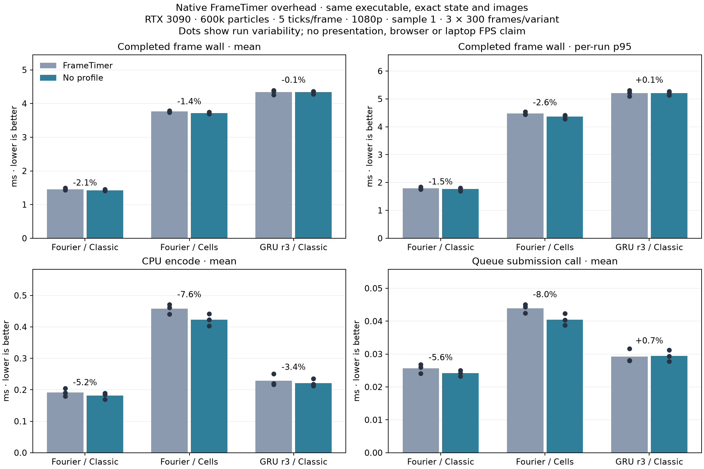
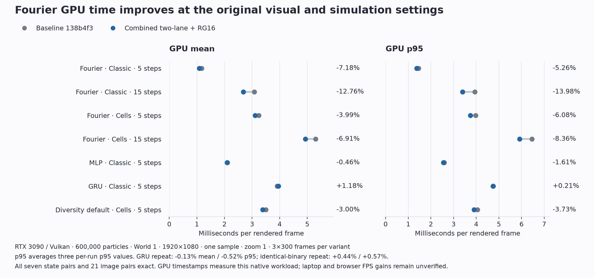
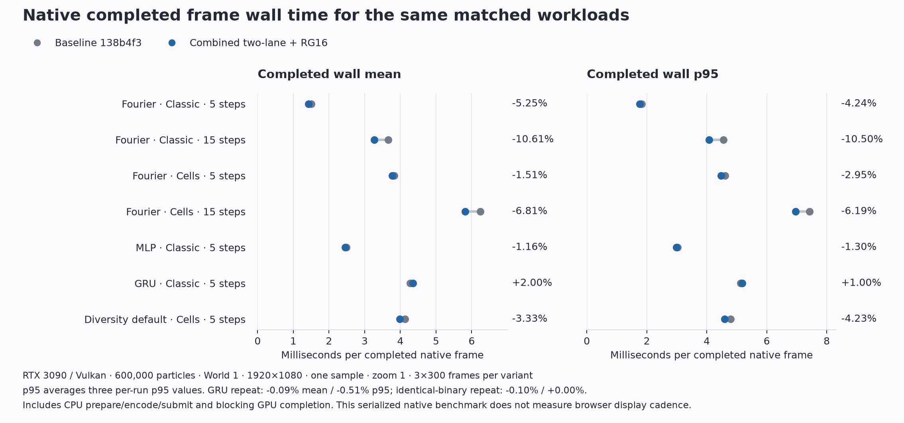
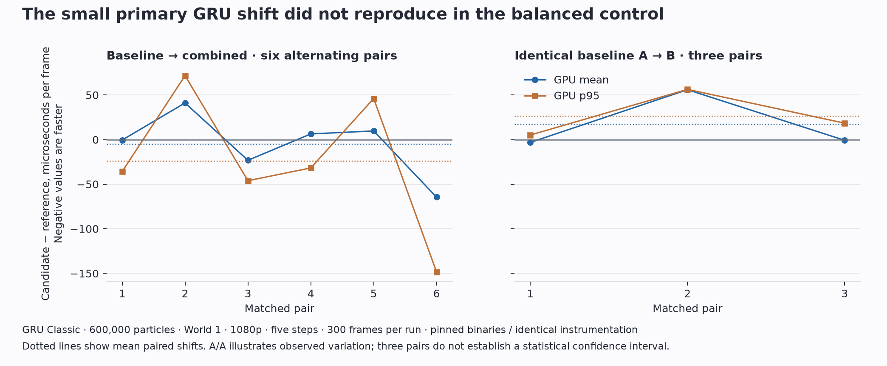
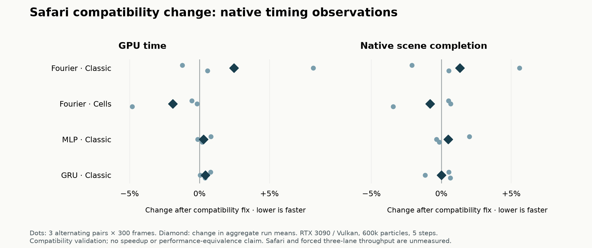

# Browser performance investigation — 2026-10-21

The campaign retains the GPU solver. The experimental CPU solver and its web
assets were removed. Changing the simulation, particle count, resolution, or
accepted appearance is not counted as an optimization.

Plots below are included in version control. Raw reports, captures, frozen
sources and binaries remain in local artifacts outside version control.

## Comparison with Fluoddity

Classic is a renderer choice. Fourier, MLP, and GRU are simulation network
choices; equal appearance does not imply equal simulation work.

The public reference checkout is pinned to
[`1db2fb4d76dd8f1e2fa569f82159c707e7a92267`](https://github.com/aphid91/Fluoddity-Web/tree/1db2fb4d76dd8f1e2fa569f82159c707e7a92267).
Its production main bundle matches the hash verified against the live studio
on 2026-10-14 in [REFERENCE.md](REFERENCE.md). This does not independently
establish the current live deployment. Both applications use WebGPU/WGSL.

| Path | Reference | Campaign entry implementation |
| --- | --- | --- |
| Fresh world before calibration | 300,000 particles, 724² trails | 600,000 particles, 1024² trails |
| Physics rate | 5 | 5 |
| First-visit calibration | Enabled | Disabled in the captured startup configuration |
| Fourier splat layout | Two integer lanes | Three active lanes in a three/four-lane allocation |
| Trail texture pair | RG16F | RGBA16F, including channels needed by newer networks |
| Fourier trail and splat allocation at world 1 | 16 MiB | 32 MiB with four-lane capacity |
| Total GPU timestamp instrumentation | Debug mode | Every scene when supported |
| Presentation | Assembly into canvas | Assembly into an offscreen texture, then egui composition |

The reference calibrates both world size and physics rate, so actual settings
on a returning laptop can differ further. This project keeps the paired
Fourier evaluation and deliberately opaque ten-center loop from the reference.
No more expensive Fourier rule was introduced by choosing Classic.

The shipped Diversity project is identical between repositories. Our captured
startup project is a modified Diversity with different parameters and cohorts;
comparisons must explicitly load the same shipped project, rather than assume
the startup project is identical because its display name matches.

These are source-confirmed differences, not measured contributions to the
reported laptop slowdown. Presentation and browser callback costs still need
matched end-to-end measurements.

## Browser observations

Isolated localhost origins were used without changing the existing user tab.
Both the unchanged reference and this application delivered approximately one
presentation per second in the available automated Chrome environment, despite
short encoding/GPU durations and documents reporting visible. The exact cause
of this callback-delivery constraint was not established.

Disabling our total GPU timer did not change this constrained cadence. These
browser samples are not a matched-workload speed comparison and do not prove
that the timer is free, that a laptop problem is fixed, or that native results
apply to browsers. Raw observations and the reference screenshot are retained
in `artifacts/local/portable-campaign-20261021/browser-observations.json`.

For repeatable browser inspection, startup URLs accept `style=classic|cells`
and `gpu-timing=on|off`. Appearance otherwise follows saved preferences.
Routine total GPU timing now samples only an already-needed scene, at most once
per 250 ms; `on` forces the former every-scene policy and `off` disables routine
totals. Explicit stage profiling and calibration retain their own behavior.
`?debug` exposes the actual workload, counters, render size, frame interval and
sampled GPU median in the DOM status line. For example:

```text
?world=1&steps=5&preset=Diversity&style=classic&debug&nocalibrate&gpu-timing=off
```

## Retained implementation

- Fourier uses two active integer splat lanes, rather than three. This reduces
  its deposit/read/clear layout from twelve to eight bytes per trail pixel.
  Neural layouts and three/four-lane allocation capacity remain unchanged.
- Fourier trail textures use RG16F, retaining the original precision of both
  vector channels. MLP/GRU keep RGBA16F for occupancy. At world size 1, the
  texture pair saves exactly 8 MiB; the combined trail/splat allocation becomes
  24 MiB, rather than the reference's 16 MiB, because spare splat capacity is
  still retained. Logical simulation allocation falls from 55,116,228 to
  46,727,620 bytes in the measured Fourier fixture.
- Mode changes prepare replacement textures, engine bindings and renderer trail
  bindings before scoped validation and out-of-memory checks. Success commits them
  together. Failure/cancellation leaves active resources intact. Same-format
  project changes retain texture identities. Painted fields, particles and the
  actual webcam field binding remain owned by the same engine.
- Renderer preparation waits during a trail-format transaction. Whole-world
  rebuilds reject pending project changes and discard pending old renderers,
  preventing stale bindings after asynchronous preparation completes.
- Routine GPU totals sample at most once per 250 ms, without a sampling timer,
  catch-up work or an extra scene submission. A busy readback ring does not
  advance the sampling deadline. Profiling changes clear statistics and drain
  inactive-source results before accepting new totals. Reports label sampled
  scenes, cadence, and result-receipt age; p95 is over those samples.
- Web builds run at normal priority by default; `LOW_PRIO=1` retains the
  optional constrained build mode.

## Instrumentation overhead control

A separate same-executable native comparison used the two-active-lane candidate
with unchanged RGBA16F trails. Three alternating pairs of 300 measured frames
per workload compared total-only timestamps with uninstrumented execution.
World 1, 600,000 particles, 1080p, five physics steps and one temporal sample
were fixed. Every run's state and image matched its paired run exactly.

| Workload | Completed wall mean, timer → no timer | Change |
| --- | --- | --- |
| Fourier Classic | 1.4540 → 1.4230 ms | −2.13% |
| Fourier Cells | 3.7636 → 3.7125 ms | −1.36% |
| GRU Classic | 4.3408 → 4.3354 ms | −0.13%, within noise |

All three Fourier mean pairs improved. Classic p95 improved on average but one
pair regressed; Cells p95 improved in all three pairs. GRU differences straddled
zero. These small native costs motivate sampling routine totals; they do not
explain severe browser slowdown or measure the final sampled app policy. The
completion timer excludes result decoding, UI and browser presentation. Do not
add these percentages to GPU reductions from another experiment.



## Combined GPU results

The entry baseline is `138b4f3f25c8b4844dc57f58f894ab3babd2cfa9`. The retained
two-lane/RG16F candidate's native checker SHA256 is
`68fb2febbc4f9488732bc1ba0f5aa41d3cd7aeb511a6df67e7c2e48d526c118c`.
Frozen sources, binaries, reports and fixtures are retained locally under
`artifacts/local/portable-campaign-20261021/`.

Seven workloads ran in three alternating baseline/candidate pairs of 300
measured frames: 42 runs, 900 frames per version per workload. World size 1,
600,000 particles, 1024² trails, 1080p output, zoom 1, bloom and one temporal
sample stayed fixed. Physics steps were five or fifteen as labeled. The
Starcrossed-derived fixtures share their seed and four cohorts; the captured
startup Diversity project is a separate fixture. These measurements use an
RTX 3090 with Vulkan, not a browser or a laptop. The table reports means of
per-run statistics; p95 values are not pooled.

| Workload | GPU mean, before → after | Mean change | p95 change |
| --- | --- | --- | --- |
| Fourier Classic, 5 steps | 1.1764 → 1.0919 ms | −7.18% | −5.26% |
| Fourier Classic, 15 steps | 3.0780 → 2.6853 ms | −12.76% | −13.98% |
| Fourier Cells, 5 steps | 3.2391 → 3.1098 ms | −3.99% | −6.08% |
| Fourier Cells, 15 steps | 5.3020 → 4.9357 ms | −6.91% | −8.36% |
| Startup Diversity Cells, 5 steps | 3.4942 → 3.3895 ms | −3.00% | −3.73% |
| MLP Classic, 5 steps | 2.1025 → 2.0928 ms | −0.46% | −1.61% |
| GRU Classic, 5 steps | 3.9066 → 3.9525 ms | +1.18% | +0.21% |

Every Fourier paired mean and p95 improved. MLP changes are small and mixed
between pairs. The initial GRU mean increased in all three pairs, so a separate
balanced six-pair repeat and three identical-baseline A/A pairs checked whether
that increase was reproducible:

| GRU control | GPU mean, first → second | Mean change | p95 change |
| --- | --- | --- | --- |
| Baseline → candidate, six pairs | 3.8780 → 3.8728 ms | −0.13% | −0.52% |
| Identical baseline → baseline, three pairs | 3.9203 → 3.9376 ms | +0.44% | +0.57% |

Repeat mean differences range from −1.65% to +1.05%, versus −0.08% to +1.43%
for identical binaries. The initial GRU shift was not reproduced and is
comparable to observed identical-binary variation. This does not establish a
confidence interval, universal neutrality or a neural-network speedup.

CPU encoding measurements vary more than GPU timings. In the primary matrix,
Fourier Cells at five steps increased from 0.4148 to 0.4682 ms (+12.88%) in all
three pairs, while the other Fourier fixtures had mixed or lower means.
The GRU repeat's encoding mean changed −0.37%; identical-baseline encoding
pairs varied from −15.88% to +5.40%. The GRU control does not establish that the
different Cells workload's encoding increase is noise. No general CPU
acceleration claim is made.

The same reports also measure wall time from frame preparation through GPU
completion, before timestamp result decoding. This includes CPU encoding,
submission and a synchronous completion wait. Both variants use identical
total-only instrumentation. It excludes egui, browser callbacks, presentation
and the compositor, so it measures native scene completion rather than user
frame rate:

| Workload | Completed wall mean, before → after | Mean change | p95 change |
| --- | --- | --- | --- |
| Fourier Classic, 5 steps | 1.5017 → 1.4228 ms | −5.25% | −4.24% |
| Fourier Classic, 15 steps | 3.6622 → 3.2736 ms | −10.61% | −10.50% |
| Fourier Cells, 5 steps | 3.8323 → 3.7746 ms | −1.51% | −2.95% |
| Fourier Cells, 15 steps | 6.2408 → 5.8155 ms | −6.81% | −6.19% |
| Startup Diversity Cells, 5 steps | 4.1238 → 3.9866 ms | −3.33% | −4.23% |
| MLP Classic, 5 steps | 2.4857 → 2.4568 ms | −1.16% | −1.30% |
| GRU Classic, 5 steps | 4.2709 → 4.3564 ms | +2.00% | +1.00% |
| GRU balanced repeat, 5 steps | 4.2478 → 4.2440 ms | −0.09% | −0.51% |
| GRU identical-baseline control, 5 steps | 4.3040 → 4.2996 ms | −0.10% | +0.00% |

Every Fourier paired completed-wall mean improves, including Cells at five
steps despite its encoding increase. Paired completed-wall p95 also improves
except one startup Diversity pair (+0.61%); its other two pairs and average
improve. These are directly measured completion times, not a subtraction or
sum of overlapping CPU/GPU timings. The original GRU completion increase also
does not reproduce in the balanced repeat. Browser acceleration remains
unverified.

All seven first-repetition full-state comparisons and all 21 paired rendered
images matched exactly, with 600,000 live particles in every run. Fourier R/G
half-float bits match exactly; absent RG16F channels are explicitly represented
as zero only after checking the old RGBA16F B/A channels are zero. Neural
four-channel comparisons remain strict. Raw two-channel captures are retained.







A separate compile-time canvas occupancy specialization passed correctness but
failed to improve performance across its 42-run comparison. It was rejected
and never applied to live source. Zero-deposit skipping, density broadcasting,
shared neural weights and paired neural evaluation experiments also failed
their measurement gates and were discarded. Only measured, equivalent changes
are retained; timing from rejected experiments is not added to the table.

## Validation and browser lifecycle

- 114 Rust tests, all three JavaScript service test files, WGSL validation,
  formatting, WASM compilation and the complete static distribution build pass.
- Hardware GPU network/layout contracts, six independent numerical cases,
  31 painted-field cases and smoke checks pass with no uncaptured GPU errors.
  Actual texture row widths and seed coordinates are format-aware; the original
  numerical oracle and tolerances are unchanged.
- GPU transition checks cover three/four-lane capacities, all neural revisions,
  prepared-project cancellation and invalid input, full reset clears, stale
  uniforms, poisoned spare capacity, the final trail texel, and preservation of
  painted fields and the actual camera binding. Six trail-camera transitions
  compare a rebound renderer against a newly constructed renderer exactly.
- Chrome exercised a paused Fourier-to-GRU switch while a resize overlapped
  pending preparation, GRU initialization at logical tick zero, resumed ticks,
  pause/undo restoring Fourier at tick zero, and X hide/show without advancing
  paused physics. Explicit stage profiling replaced routine totals; disabling
  it cleared the statistics before sampled totals resumed. No GPU/console
  errors were recorded.
- During a recorded 15.861-second pause interval, scene submissions remained
  351 and completed ticks remained 5,235. Two UI service passes drained pending
  work; the final repaint deadline was `None`. This measures scheduling rather
  than energy consumption.

Browser evidence is retained in the campaign's `browser-lifecycle.json`,
`final-classic-browser.png`, and `browser-profiler-on.png` /
`browser-profiler-off.png`. Screenshot capture timed out after a viewport
resize; DOM lifecycle checks continued, the viewport override was reset, and
fresh-tab screenshots succeeded. The timing constraint described above still
prevents a browser frame-rate acceptance claim. No particular laptop GPU or
vendor is targeted, and equivalence to desktop browser responsiveness remains
unverified on the reported systems.

## Safari shader compiler compatibility follow-up

The MacBook Safari report identified an independent startup failure in
`entityUpdate.wgsl`. WebKit generated an atomic compare-exchange result whose
field type was `thread int`, which Metal rejects. The reported helper matches
the defect corrected in [WebKit's translator](https://github.com/WebKit/WebKit/blob/4f56cc248e8a2e447f77d54d7612d2a6128daccb/Source/WebGPU/WGSL/Metal/MetalFunctionWriter.cpp#L745-L761).
The unused narrow occupancy helper was still compiled for Fourier despite its
false specialization branch. Safari release inclusion of the upstream fix was
not established. Preserving the first GPU error also prevents later invalid
encoder errors from hiding the compiler failure.

The narrow occupancy path now uses exchange-and-merge accumulation. Contributions
may temporarily reside in invocation locals; the canvas reads only after the
entity dispatch completes. Its saturated sum and integer bounds are preserved.
The wide add/carry path, network equations, render quality, buffers and device
requirements are unchanged. This is a shared implementation change, with no
browser detection.

An independent finite-state model checked 668,633 states across 1,406 cases,
including termination, followed by 32 randomized 1,024-contender schedules.
Hardware checks passed all 54 occupancy mode/layout/case combinations, each
repeated three times against the frozen CAS implementation and independent
host sums. These include forced three-lane allocation, 4,099 contending
invocations, unsaturated and already-saturated counters, untouched pixels and
momentum sentinels. Numerical, painted-field, transition and smoke checks passed.

Four workloads then ran three alternating pairs of 300 measured frames against
the prior production GPU checker, with the campaign's world-1, 600,000-particle,
1080p, five-step fixtures. All four first-repetition full states and all twelve
paired PNGs matched exactly. GPU mean changes were +2.46% for Fourier Classic,
−1.91% for Fourier Cells, +0.29% for MLP Classic and +0.40% for GRU Classic.
Fourier Classic pairs varied from −1.23% to +8.14%. Cells CPU encoding increased
by 0.0267 ms (+6.26%) in all three pairs, while its completed-frame mean fell
0.81%; that encoding observation remains unexplained. These RTX 3090/Vulkan
measurements establish neither a speedup nor performance equivalence.



Forced three-lane correctness is covered; its throughput is unmeasured. Original
Safari compilation and continued simulation require a reload of the deployed
build on the reported MacBook. Native tests and Chrome do not establish that
acceptance. Raw evidence remains under
`artifacts/local/macbook-encoder-20261021/` and the campaign's
`macbook-exchange-primary/` directory.
