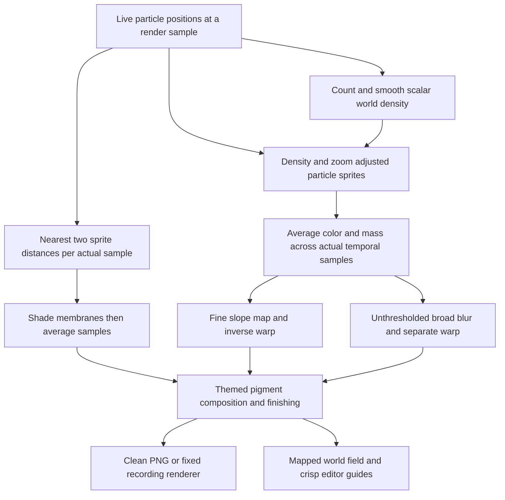

# Cellular rendering

Status: implemented as an optional first visual style, 2026-10-16. The original
3 ms added GPU-work target is **not met**; measured costs and coverage are in
[CELLULAR_RENDERING_VALIDATION.md](CELLULAR_RENDERING_VALIDATION.md).

## The idea, simply

Draw particles into an image, measure how closely they cluster, and adjust their
visible size. Treat the accumulated image's intensity as a small height map:
its slopes bend the image slightly and shade its edges. Repeat that operation
on a much softer image for the background color. Compose the pigment over a
dark background by default, with an optional pale Light theme, glow, contrast,
chromatic separation and sharpening.

This changes the picture. It does not add biological cells or change the
particles' network, motion, trails or memory. The appearance described here is
an artistic direction, not an exact reconstruction of another application's
equations. The target look is soft, translucent cells with visible walls, in
colored bands that blend where they meet.

## Using it

Select **Style → Cells** in the toolbar, or under **Controls → Display**.
**Classic** remains the default for old preferences. In Cells, choose **Dark /
Light** beside Style or under Display; Dark is the default. Appearance is
independent of **Fourier / MLP / GRU**. The Particles / Trails switch still works;
Trails retains its existing vector-field view.

| Control | Effect | Default / range |
| --- | --- | --- |
| Theme | Dark background or pale paper; independent of palette | Dark |
| Cell Scale | Particle radius before density and zoom response | 1.5× / 0.5–4× |
| Cell Membranes | Soft packed cell walls and subdued interiors when zoomed in | 1 / 0–1 |
| Density Response | Smaller marks in crowded regions | 0.4 / 0–1 |
| Structure Threshold | Fade fine grain below a local occupancy threshold; try 1–2 | Off (0) / 0–4 |
| Cell Relief | Fine image displacement in reference pixels | 0.65 / 0–0.9 |
| Color Wash | Soft pigment underneath the detailed image | 0.35 / 0–1 |
| Advanced green / pink palette | Optional green and pink colors | Off; existing particle hues |
| Brightness / tone softness | Expose and compress pigment intensity | Existing preferences |
| Advanced contrast | Shade local edges | 0.5 / 0–2 |
| Advanced chromatic split / sharpening | Subtle color and detail finishing | Both off |
| Advanced zoom response | Continuous particle-size response to zoom | 0.65 / 0.2–1 |
| Advanced detailed density | Approximately 512² instead of 256² occupancy cells | Off |

Controls are under the existing **Advanced** switch when appropriate. The
palette follows the existing behavior/cohort color signal and color controls;
overlapping colors can mix. Zooming changes the view and visible grain, not the
number of simulated particles. Color Wash and Bloom are independent. Fine pigment opacity compensates for the
density-adjusted sprite enlargement, capped at the original 24-reference-pixel
radius. Dark fine pigment receives extra exposure for visibility; the broad wash
and original camera range (0.1×–100×) are unchanged.

Structure Threshold uses the existing smoothed world-space density at its base
level: 1 is approximately a uniformly dispersed population. Fine pigment, edge
shading and bloom marks fade from hidden at the threshold to fully visible at
1.5 times it. Zero preserves the original image. The broad Color Wash and
interaction displacement remain unchanged. This detects local clustering, not
connectivity; a sparse coherent strand can also fade at higher thresholds.
The setting is saved with appearance preferences and applies to clean exports.

## Pipeline and numerical rules



### Scalar density

The simulation's trail grid contains signed velocity vectors. Opposing
velocities can cancel there, so it cannot measure occupancy. Cells owns an
independent grid with approximately 256² cells, or 512² at detailed quality.
Both preserve world aspect. It is fixed in world coordinates: zoom and output
resolution do not change its world-space smoothing radius.

Each live slot adds one `u32` count to its containing cell. Dead slots are
excluded. Wrap worlds wrap positions and convolution samples. Other worlds
exclude positions outside the domain, allowing small floating-point boundary
roundoff, and use zero density beyond the boundary.

With `G` grid cells and `N` allocated particle slots, relative occupancy is
`count * G / N`. A uniform live population is approximately 1; deaths lower the
value. A normalized separable Gaussian has world-space standard deviation
`1 / 128` on each axis, with three-sigma discrete support. Grid dimensions and
world cell widths determine each axis's sigma. The resulting R32Float texture
has averaged mip levels, sampled with explicit bilinear interpolation. Float32
texture filtering and float atomics are not required.

Counting, smoothing and drawing repeat for **each actual motion-blur sample**,
using the same particle state. Density is independent of exposure, palette,
cohort selection and visible point size.

### Sprites and energy

At a 1080-pixel short edge, one reference pixel is one output pixel. Let
`s = min(output_width, output_height) / 1080`.

```text
crowding = max(sample_density(position), 0.1)
size_factor = clamp(crowding ^ (-density_response / 2), 0.5, 2)
radius_px = clamp(1.5 * cell_scale * zoom ^ zoom_response * size_factor * s,
                  max(0.75, s), 24 * s)
```

Each circular Gaussian targets integrated mass `0.4 * s²`. This makes matched
framing at higher resolution retain its relative intensity, rather than making
4K marks four times weaker. Footprints up to three physical pixels use discrete
normalization, including subpixel position; larger footprints use the truncated
continuous Gaussian normalization. Larger discrete footprints retain a small
sampling error. Pixel rasterization still limits extremely small outputs.

Wrap worlds draw periodic neighbor copies. Radius is additionally capped at
`0.49 * smallest projected world period`, so copies of one particle cannot
contribute twice to a pixel. If an exceptionally thin projected world forces
radius below one reference pixel, its energy attenuates with that footprint.
This is an explicit sampling limit, not an automatic change to the world.
Exterior copies cover the overscan needed by filtering and displacement.

Direct RGBA16F additive accumulation loses small contributions in dense piles
and can eventually overflow. Cells instead adds RGB, mass and selected-cohort
mass into five **integer atomic buffers**, converts bounded batches into
RGBA32Float / R32Float images, and adds the batches there.

- Every fragment is capped at mass 0.62; RGB channels and selected mass are
  individually bounded by mass.
- Batches contain at most 262,144 particles. Above a six-reference-pixel radius
  bound, including the physical minimum footprint, they contain at most 65,536.
  Precision therefore does not collapse as total population grows.
- Quantum `Q` obeys `batch_count * (ceil(0.62 * Q) + margin) <= u32::MAX`.
  The implementation reserves two counts per contribution and caps Q at 2²⁴.
- Independent RGB rounding avoids compounding rounded-mass errors.
- Each batch uses the same `1 / actual_temporal_samples` weight. Density is
  counted once per temporal sample; the temporal count advances once after all
  batches. No batch uniform is overwritten between encoded draws.

The pre-exposure color/mass image is always **unhighlighted**. A separate selected
mass image supplies display-only dimming during final assembly. Clearing a
selection or exporting a held blurred image does not reconstruct old particle
states or discard temporal color.

### Zoom and membranes

Cell Membranes blends from solid pigment to shaded cells continuously between
2× and 8× camera zoom. At the full-world view there is no membrane work; the
existing Structure Threshold keeps scattered fine grain subdued. At close zoom,
isolated cells have rounded outer walls and neighboring cells acquire soft
polygonal contact edges. Interiors retain a faint tinted fill. The broad wash
is reduced to 30% of its selected strength as membranes blend in, allowing the
walls to remain readable. All hues still come from the existing particle palette.
Set Cell Membranes to zero to restore the prior solid-pigment rendering.

For every actual temporal sample, the sprite raster also retains its two nearest
radius-normalized squared distances per pixel. Reversed positive-float bit keys
use zero for an absent site; two atomic maxima preserve the nearest two values,
including ties. These buffers are cleared per sample and retained across all
particle batches. A separate compute pass converts the exterior/contact gap to
an approximate screen-pixel rim width and a soft interior. Flat equal-distance
neighborhoods from coincident particles retain one exterior rather than filling
the disk with a false contact wall.

Appearance factors are shaded **before** temporal averaging into a separate
buffer. The final post pass bilinearly samples that averaged field at the same
warped coordinate as pigment, multiplying fine pigment and bloom marks together.
This preserves the original mass normalization, selected ratio and displayed
interaction map. Colors remain locally averaged in overlapping regions; this
is a stylized membrane view, not a physical foam or a simulation change.

Two buffers add **16 bytes per padded output pixel**, approximately 43.4 MiB
at 1080p and 172.5 MiB at 4K. This storage remains allocated while Cells is
active, including at full-world zoom and with Cell Membranes at zero. Preparation
checks seven sprite storage bindings and each new eight-byte-per-pixel binding
against the device limits. Failed preparation uses the existing appearance
rollback path.

### Relief, wash and composition

The height signal is compressed achromatic mass, `log(1 + 64 * mass)`, independent of
exposure and hue. Central differences produce a bounded fine displacement. It
is stored in reference-pixel units on an RGBA32Float map with at least eight
reference pixels between nodes; the displayed map is bilinearly interpolated.

The relief limit changed from the original 4-pixel proposal to **0.9 reference
pixels**. Its two-dimensional infinity-norm Lipschitz bound is at most 0.45:
`4 * 0.9 / 8`. Consequently `p -> p + displacement(p)` is invertible, and ten
fixed-point iterations recover the displayed position to below 0.003 reference
pixels in the adversarial numerical fixture. Clamped map extension preserves
that contraction. Float32 displacement avoids low-precision absolute-UV error.

The unthresholded wash uses a separate half-resolution mip pyramid. Each
downsample applies a normalized 8×8 Gaussian and aligns actual texel centers,
including odd dimensions. A finer mip and positive cubic B-spline reconstruction
keep compact clumps from exposing square texel footprints. RGB sums and mass
are filtered together; the analytic slope of that same reconstructed field
drives its small displacement. It does not reuse the thresholded Bloom chain.

Overscan covers the Gaussian, cubic support, maximum sprite size and finishing,
with an additional physical-pixel guard for small/odd outputs. At extreme
zoom-out, filter support and displacement are limited by the projected wrapped
world period. The wash fades between periods of 16 and 32 physical pixels so
neighbor copies remain sufficient.

Recover pigment as `color_sum / mass` where mass is present. Brightness and tone
softness expose and compress mass once, then opacity blends broad and fine
pigment over the selected background. Contrast uses local height curvature. Sharpening reads
neighboring resolved shades; optional chromatic separation affects scene color.
Bloom is driven by colored marks. Composition, selection dimming and the final
domain mask share the committed theme background, including clean exports.
The domain mask restores that background **after** all finishing and Bloom.

Fine and broad warps run after temporal averaging, not on each individual
sample. The existing scheduler supplies the actual sample count; rendering does
not request extra simulation ticks.

## Interaction, persistence and exports

Input uses the map, camera and dimensions of the last submitted displayed Cells
image. A pointer is mapped through that displayed texture even if an allocation
failure has retained and stretched an older output size.

Picking uses the forward inverse-render map. Painting evaluates every field
texel through the inverse map before testing the visible circle or stroke;
mapping only the cursor would give the wrong footprint. Brush direction and
shove vectors are transformed too. World-field overlays follow the fine warp;
reticles, crop guides and egui remain crisp. The broad wash is decorative and
not selectable. A blurred path still differs from a particle's final live state,
as in the existing renderer.

Appearance changes invalidate paused rendering. A settled, unchanged paused
scene performs no density or finishing work. Removing a highlight can reuse its
cached unhighlighted temporal base. Appearance alone leaves positions,
velocities, vector trails, rule weights, GRU memory and logical ticks untouched.

Preferences store Cells settings separately from rule/network banks. Old
preferences default to Classic. Theme-absent prototype Cells settings migrate
to Dark and the normal particle colors; explicit new theme/palette choices
survive reload in both JSON and eframe RON. Project JSON and rule-only legacy share links
do not acquire appearance fields. A PNG preserves the rendered look in its
pixels; its optional project QR code retains the existing rule-only meaning.

Clean PNG assembly reuses the unhighlighted resolved image, including held motion
blur, then applies the same final look without editor overlays. Cropping happens
after the full-frame processing. Recording freezes preferences and project in its
own fixed-size, full-world renderer, independently of preview pan, zoom or resize.

Display and recording resources are prepared under validation/OOM scopes before
activation. Failure retains the working display, restores the committed
style/quality, and exposes Retry appearance. Failed allocation keys prevent an
expensive repaint retry loop. Optional Cells resources are released when no
active renderer references them; there is no CPU renderer or silent reduction
of particles, simulation rate or density quality.

## Cost and limits

The implementation prioritizes concentrated-population precision and reliable
interaction over the original optimistic storage estimate. Fullscreen clears
and float additions scale with batch count; wrapped sprites also process
neighbor instances. Large particles increase overdraw.

At 600,000 particles on the RTX 3090 test device, one fixed-state sample measured
**6.39 ms at 1080p**, including Bloom/assembly, versus **0.55 ms for Classic**.
Four samples measured 20.91 ms; one 4K sample measured 11.06 ms. These are native
GPU timestamps for a bounded snapshot, not browser FPS or simulation throughput.
The proposed 3 ms added-work target remains unmet. Reducing duplicated sprite
preparation and batch traffic is future performance work.

Logical Cells-only storage is approximately **214 MiB at 1080p** and **844 MiB
at 4K** with default density quality, including overscan, integer buffers,
float temporal images, mask, wash, maps and final targets. Existing renderer and
simulation storage are additional. Old/new resources overlap during preparation;
display and recording can also coexist. Driver heap/alignment overhead is not
included. See the validation report for actual byte counts and test boundaries.

## Source and evidence

- [Cells resources and orchestration](../src/cells.rs)
- [Cells shaders](../shaders/cells/)
- [Renderer integration](../src/render.rs), [frame assembly](../shaders/render/frameAssembly.wgsl)
- [Input mapping](../shaders/cells/cellsInteraction.wgsl), [GPU bindings](../src/gpu.rs)
- [Preferences and controls](../src/controls.rs), [application lifecycle](../src/app.rs)
- [Recording](../src/record.rs), [GPU checks](../src/bin/gpu-check.rs), [numerical tests](../tests/cells_math.rs)
- [Validation results and limitations](CELLULAR_RENDERING_VALIDATION.md)
